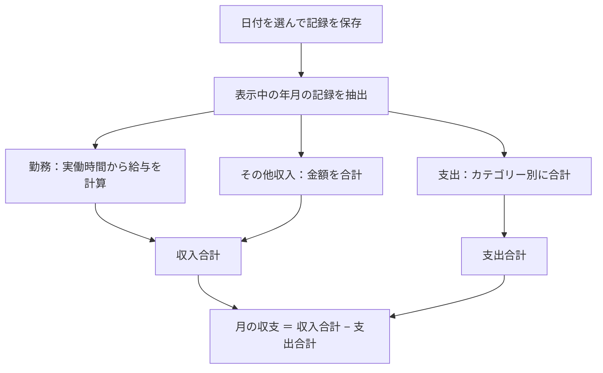

# こよみ帳

シフトと日々の収支を、ひとつのカレンダーで管理するWebアプリです。勤務を登録すると、時給と休憩を除いた実働時間から給与見込みを計算します。Googleアカウントでログインすると、PCで入力した帳簿をスマホでも開いて編集できます。

**[こよみ帳を開く](https://sirius74-w.github.io/sirius74-W2.github.io/)**

## はじめに

まず画面を試したいときは **「記入例を見る」** を押します。**「自分の帳簿に戻る」** で自分の入力を始められます。帳簿は次の2通りで使えます。

| 使い方 | 保存場所 | 次に開くとき |
| --- | --- | --- |
| その端末だけで使う | 使用中のブラウザー | 同じ端末・ブラウザーで公開サイトを開く |
| PCとスマホで使う | Supabase上のアカウント別の帳簿 | それぞれの端末で同じGoogleアカウントを選ぶ |

## PCとスマホで同じ帳簿を使う

1. PCでこよみ帳を開き、**「ログイン・同期」→「Googleでログイン」** を押します。
2. **すでに勤務や支出を入力している場合**は、それを入力した端末・ブラウザーでログインします。最初のクラウド帳簿は空です。**「アカウント」→「端末内の記録を取り込む」** を開き、取り込み先のアカウントと件数を確認して **「このアカウントに取り込む」** を押します。初めて使う場合は、そのまま記録を追加できます。
3. PCで今日の支出に「食費 100円」を保存し、**「クラウドに保存済み」** の表示を確認します。
4. スマホで同じ公開サイトを開き、同じGoogleアカウントでログインします。今日の100円を120円に編集して保存し、PCで **「アカウント」→「最新の帳簿を取得」** を押すと、変更を確認できます。テスト用の明細は確認後に削除できます。

ログアウトすると、そのブラウザーの端末内帳簿に戻ります。クラウドに保存した記録は、同じアカウントで再度ログインすると開けます。

## 記録のしかた

1. **勤務パターンを登録する。** 「勤務パターン」で「平日夕方」「休日早番」などの名前を付け、時給と開始・終了時刻を入力します。最大10件まで登録できます。
2. **シフトを入れる。** カレンダーで働く日を選び、「勤務」を押します。登録したパターンを選ぶか、その日だけの時給と勤務時間を直接入力して保存します。
3. **収入や支出を入れる。** 日付を選び、「支出」から金額とカテゴリーを入力します。食費・交通費・娯楽費・交際費などがあり、自分でカテゴリーも追加できます。給与以外のお金が入ったときは「収入」を使います。
4. **月の合計を確認する。** カレンダーには収入合計・支出合計・月の収支が表示されます。「支出の内訳」ではカテゴリー別の合計、「収支明細」では個々の記録を確認できます。入力を直すときは、該当の記録を開いて編集します。

## 画面の裏側で何が起きるか

たとえばカレンダーの11月5日に「早番」を入れると、こよみ帳は **11月5日の勤務記録を1件** 保存します。その日を開くと個別のシフトが見え、11月全体を表示すると同じシフトの給与が月の収入に含まれます。カレンダーと月の合計は、同じ記録を異なる単位で表示しています。

### 勤務パターンと勤務記録の違い

「勤務パターン」は繰り返し使う入力用のひな形です。パターンを選ぶと、勤務名・時給・開始時刻・終了時刻・休憩の設定が、その日の入力欄にコピーされます。その日だけ早退した場合は、終了時刻を直してから保存できます。

たとえば12月から時給が1,200円から1,250円に上がったら、勤務パターンの時給を変更します。11月に保存したシフトには登録時の1,200円が残ります。すでに12月のシフトも登録していた場合は、該当する日の勤務記録を開いて時給を変更してください。**10件という上限はひな形の数**で、ひとつのパターンを複数の日に使えます。

## 給与と収支の計算

休憩欄を空欄にすると、開始から終了までの長さに応じて、次の分数を自動で差し引きます。実際に取った休憩が異なる日は、休憩欄にその分数を入力してください。

| 開始から終了まで | 自動で差し引く休憩 |
| --- | ---: |
| 6時間以内 | 0分 |
| 6時間超～8時間以内 | 45分 |
| 8時間超 | 60分 |

**計算例**　時給1,200円で9:00～18:00に働く場合、9時間から休憩60分を引くと実働は8時間です。給与見込みは **1,200円 × 8時間 ＝ 9,600円**。同じ月に食費800円を記録し、ほかに記録がなければ、月の収支は **9,600円 − 800円 ＝ 8,800円** です。

- 給与は1勤務ごとに「時給 × 実働分数 ÷ 60」で計算し、1円単位に四捨五入します。
- 終了時刻が開始時刻より早い勤務は翌日終了として扱い、給与は勤務を開始した月に計上します。
- 月の収支は「給与見込み ＋ その他の収入 − 支出合計」です。シフトから計算した給与は自動で収入に含まれるため、同じ給与を「収入」にも入力すると二重に計上されます。

### 日付をまたぐシフトの計算例

11月30日 **22:30～翌6:00**、時給 **1,200円**、休憩欄が空欄の場合を考えます。

| 計算するもの | 計算の過程 | 結果 |
| --- | --- | ---: |
| 開始から終了まで | 22:30～24:00の90分 ＋ 翌0:00～6:00の360分 | 450分 |
| 実働時間 | 450分 − 自動休憩45分 | 405分（6時間45分） |
| 給与見込み | 1,200円 × 405分 ÷ 60 | 8,100円 |

この8,100円は開始日の属する**11月**にまとめて計上されます。実際の休憩が30分なら、休憩欄に `30` と入力すると実働は420分、給与見込みは8,400円に変わります。給与は登録した時給で計算し、深夜・残業の割増や税金・保険料は自動計算しません。

### カテゴリーの合計と円グラフの読み方

次の5件だけを登録した月を例にします。

| 日付 | 種類 | 内容 | 金額 |
| --- | --- | --- | ---: |
| 11月5日 | 勤務 | 早番の給与見込み | 9,600円 |
| 11月5日 | 支出 | 食費（昼食） | 800円 |
| 11月6日 | 支出 | 交通費（電車） | 400円 |
| 11月8日 | 支出 | 食費（軽食） | 400円 |
| 11月10日 | 収入 | 臨時収入 | 2,000円 |

収入合計は **9,600 ＋ 2,000 ＝ 11,600円**。支出は日付が違っても同じ月・同じカテゴリーなら一緒に集計するので、食費が **1,200円**、交通費が **400円** になります。円グラフは支出合計1,600円を全体とし、食費が75%、交通費が25%を占めます。月の収支は **11,600 − 1,600 ＝ 10,000円** です。

11月5日の昼食を800円から600円に訂正すると、食費は1,000円、支出合計は1,400円、月の収支は10,200円に更新されます。明細を1件直すだけでよいのは、保存した各記録から毎回合計を計算するためです。

## 保存と同期の仕組み

端末内帳簿はブラウザーのローカルストレージに保存します。サイトデータを削除すると端末内の記録も消えるため、残したい記録は先にクラウドへ取り込んでください。取り込み後も元の端末内帳簿は残ります。ダウンロードしたHTMLで入力した記録と、公開サイトで入力した記録は保存場所が異なります。

クラウド帳簿では、Googleログインで本人を識別し、Supabaseに勤務・収入・支出・勤務パターンを保存します。GitHub Pagesはアプリを配信し、帳簿の読み書きはSupabaseが担当します。データベース側の行単位のアクセス制御（RLS）で、ログイン中の利用者が自分の記録だけを読み書きできるようにしています。

- **2台で同じ明細を編集したとき**は、保存時に記録の版番号を確認します。ほかの端末が先に保存していたら、最新の明細を開き直してから変更を反映します。
- **保存中に通信が切れたとき**は、入力画面を開いたまま再接続して保存します。クラウドへの保存完了は「クラウドに保存済み」で確認できます。
- **共用端末**では、使い終わったら「アカウント」からログアウトしてください。ログアウト後に表示される端末内帳簿は、同じブラウザープロフィールを使う人と共通です。

## 自分の環境で公開する

公開済みのこよみ帳を使う人は、上のリンクからそのまま始められます。自分のGitHub PagesとSupabaseで運営する場合は、同期対応版のファイルを使います。

| ファイル | 役割 |
| --- | --- |
| `index.html` | こよみ帳の画面、スタイル、給与計算と同期処理。ビルドは不要 |
| `config.js` | ブラウザーが使うSupabaseのProject URLとPublishable keyを設定 |
| `setup.sql` | SupabaseのSQL Editorで一度実行し、帳簿テーブル・アクセス制御・保存処理を作成 |
| `verify.sql` | 初回ログイン後にSQL Editorで実行し、アクセス制御や更新の競合処理を確認 |
| `SETUP.md` | 同期対応版に付属する管理者向けの設定手順 |

1. Supabaseにプロジェクトを作成し、Data APIを有効にして `setup.sql` を実行します。
2. Google Cloudでウェブ用のOAuthクライアントを作成します。JavaScript生成元には公開サイトのドメインまで、リダイレクトURIにはSupabaseのGoogle設定に表示される **Callback URL** を登録します。
3. SupabaseでGoogleプロバイダーを有効にし、GoogleのClient IDとClient Secretを設定します。Supabaseの **Site URL** と **Redirect URLs** には、ログイン後に戻る公開サイトのURLをリポジトリ名と末尾の `/` まで含めて登録します。
4. `config.js` にProject URLと **Publishable key**（`sb_publishable_` で始まる公開用キー）を設定し、`index.html` と同じ階層に置いてGitHub Pagesで公開します。GoogleのClient Secret、Supabaseの秘密キー、DBパスワードは公開ファイルに含めないでください。
5. このリポジトリでは、GitHubの **Actions → Deploy static content to Pages** で公開結果を確認できます。公開URLからログインし、上記の手順で端末間の同期を試します。

**公式の設定資料**　[SupabaseのGoogleログイン設定](https://supabase.com/docs/guides/auth/social-sign-in/auth-google) ／ [GitHub Pages](https://docs.github.com/ja/pages)

## 困ったとき

| 症状 | 確認すること |
| --- | --- |
| ログインしたら以前の記録が見えない | 元の端末・ブラウザーで「アカウント」を開き、「端末内の記録を取り込む」を選ぶ |
| PCの変更がスマホに出ない | 両端末のログイン先と表示月を確認。PCの保存完了後、スマホで「最新の帳簿を取得」を押す |
| Googleで `redirect_uri_mismatch` が出る | Googleに登録したリダイレクトURIと、SupabaseのCallback URLが完全に一致しているか確認する |
