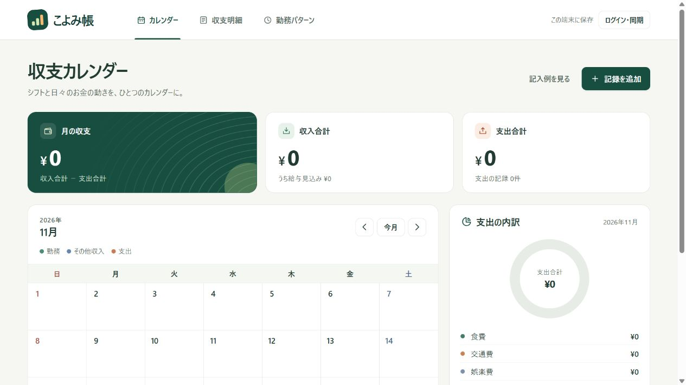
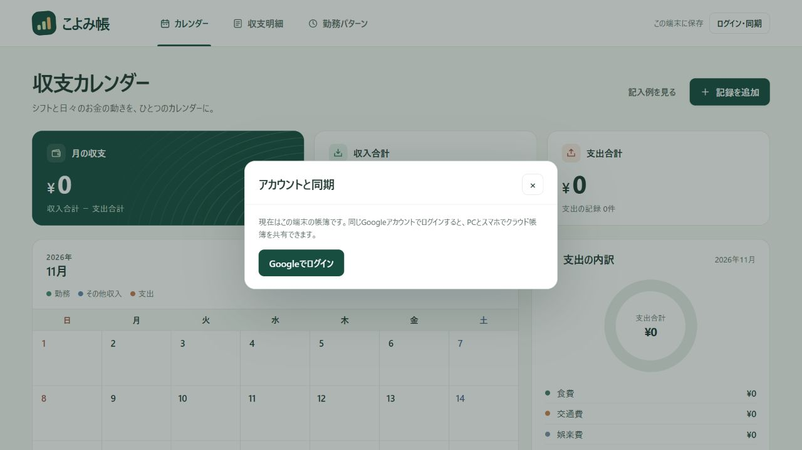
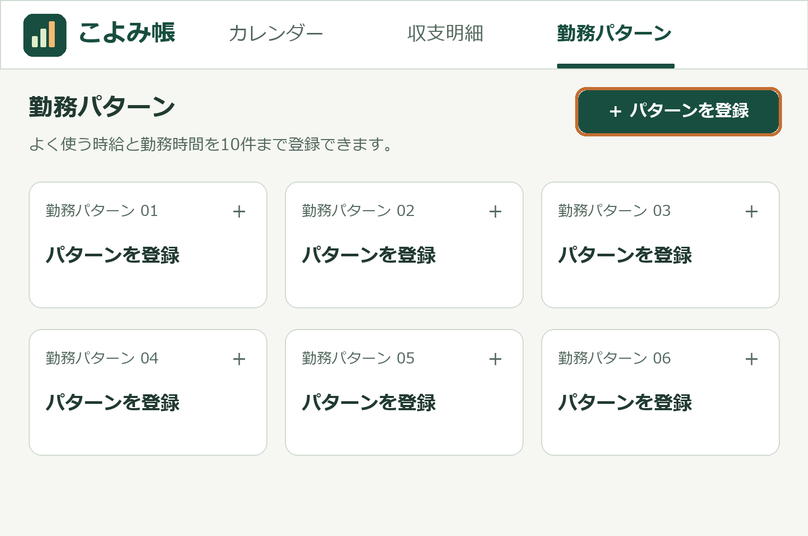
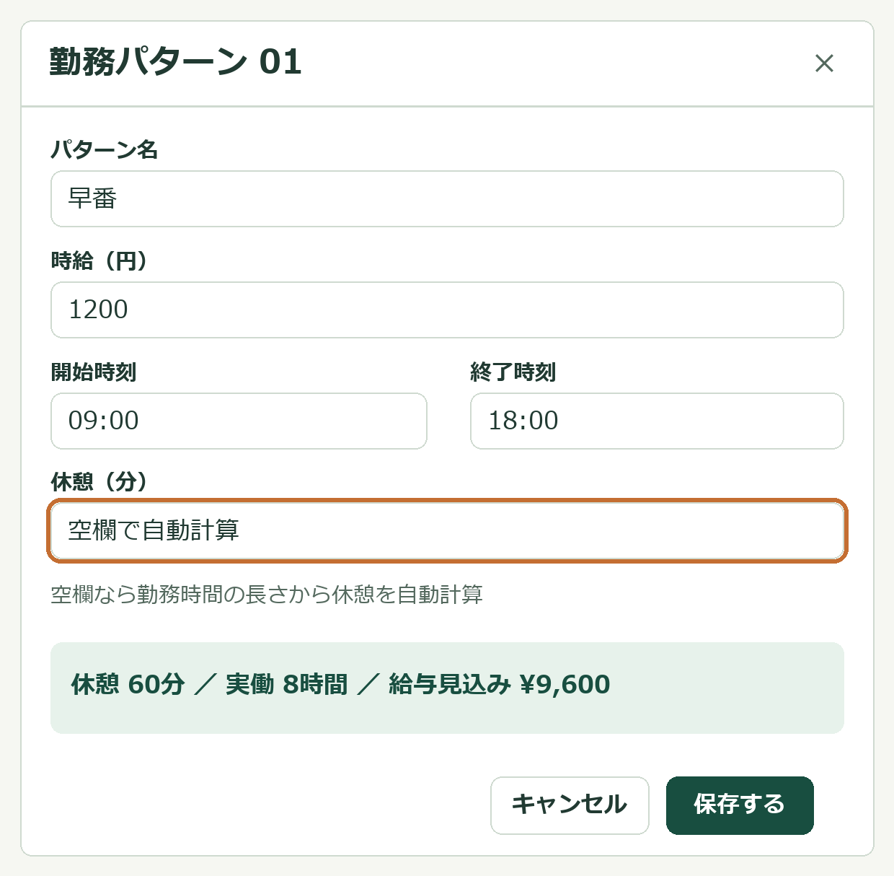
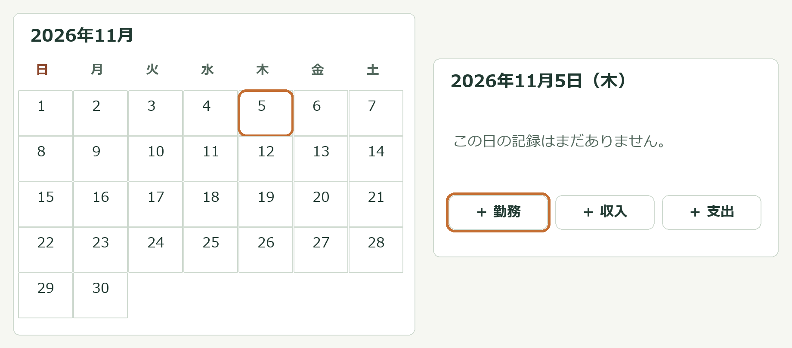
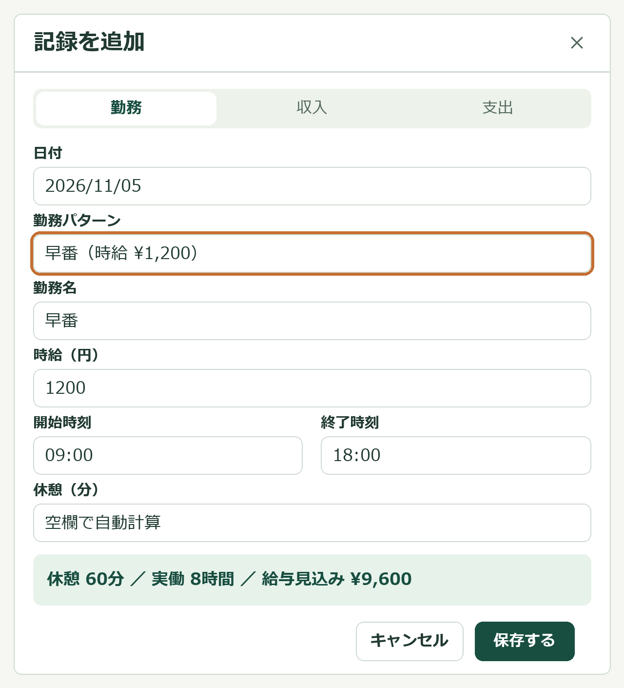
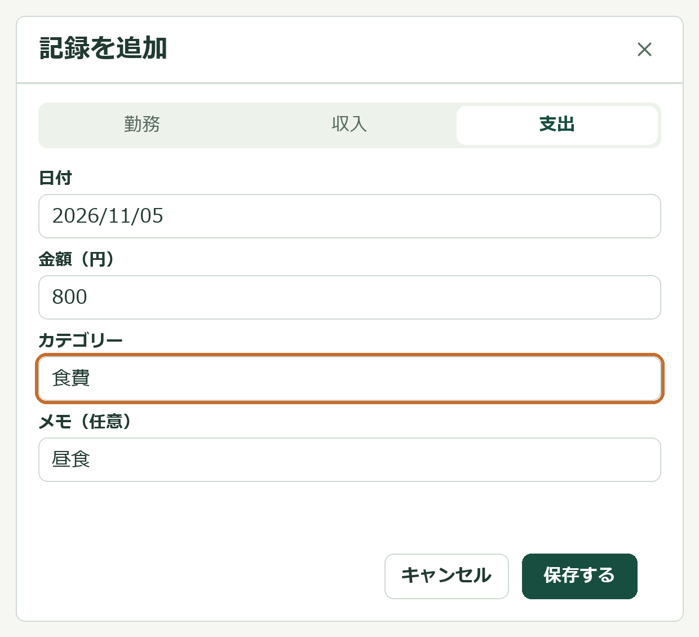
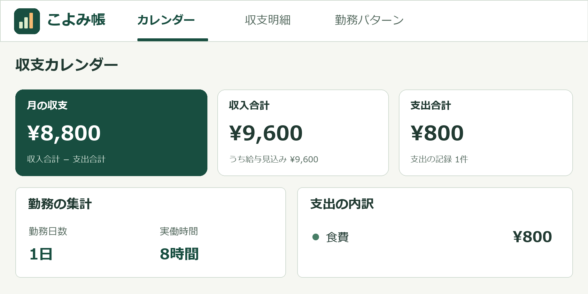

# こよみ帳の使い方

こよみ帳を開いたら、まず帳簿の保存先を選びます。そのあと、早番の給与9,600円と昼食代800円を例に、カレンダーへの入力から月の収支の確認までを試せます。

**[こよみ帳を開く](https://sirius74-w.github.io/sirius74-W2.github.io/)**

## 最初に、どの端末で使うか決める

**この端末だけで使う場合**は、公開サイトを開いたら、そのまま「1. よく使う勤務」へ進んでください。次回も同じブラウザーで同じURLを開くと続きから使えます。入力前に見本を試すときは「記入例を見る」、自分の入力を始めるときは「自分の帳簿に戻る」を押します。

**PCとスマホで同じ帳簿を使う場合**は、公開サイトの上部にある **「ログイン・同期」** を押します。

「アカウントと同期」が開いたら、**「Googleでログイン」** を押して、帳簿に使いたいGoogleアカウントを選びます。スマホでも同じ公開サイトを開き、同じアカウントを選んでください。ここまでの2枚は公開サイトの画面写真です。

### ログイン前に入力した記録があるとき

初回ログイン後に空の帳簿が開くことがあります。以前の記録は、入力したブラウザーの端末内帳簿にあります。

1. 以前使っていた端末・ブラウザーで公開サイトにログインし、**「アカウント」** を開きます。
2. **「端末内の記録を取り込む」** を押し、取り込み先のアカウントと勤務・支出などの件数を確認します。
3. **「このアカウントに取り込む」** を押して、以前入力した月を開きます。元の端末内帳簿にも記録は残ります。

## 給与と支出を記録してみる

以下の操作図では、入力する欄や押すボタンをオレンジ色の枠で示しています。例は11月5日です。自分の帳簿に登録するときは、実際の日付と金額に置き換えてください。

## 1. よく使う勤務を「早番」として登録する

上部の **「勤務パターン」** を開き、**「＋ パターンを登録」** を押します。空いている「勤務パターン 01」などの枠を選んでも同じ入力画面が開きます。

次のように入力します。休憩欄は**空欄のまま**にしてください。空欄なら自動で計算され、`0` を入力すると休憩0分として扱われます。

| 入力欄 | 今回の入力 |
| --- | --- |
| パターン名 | 早番 |
| 時給（円） | 1200 |
| 開始時刻・終了時刻 | 09:00・18:00 |
| 休憩（分） | 空欄 |

**「保存する」** を押します。ここで保存したのは繰り返し使える入力パターンです。次に、働いた日を選んで給与をカレンダーに反映します。パターンは10件まで登録でき、同じ早番を何日でも使えます。

## 2. カレンダーにシフトを入れる

**「カレンダー」** に戻り、働いた月を表示します。別の月に移動するには、月表示の横にある左右のボタンを使います。例では **11月5日 →「＋ 勤務」** の順に押します。

**「勤務パターン」** の欄で **「早番（時給 ¥1,200）」** を選ぶと、先ほど登録した時給と時刻が入ります。その日だけ終了時刻が違う場合は、この画面で直せます。パターンを作っていない勤務も、時給や時刻を直接入力すれば登録できます。

画面下部で **休憩60分・実働8時間・給与見込み9,600円** と表示されることを確認し、**「保存する」** を押します。9:00〜18:00の9時間から休憩1時間を引くので、給与は **8時間 × 1,200円 ＝ 9,600円** です。

> **実際の休憩が違うとき**は、その日の「休憩（分）」に実際の分数を入れます。自動計算の初期値は、開始から終了までが6時間以内なら0分、6時間超〜8時間以内なら45分、8時間超なら60分です。

## 3. 同じ日に昼食代800円を入れる

11月5日の日別画面で **「＋ 支出」** を押します。日別画面を閉じていたら、カレンダーの5日をもう一度押してください。

**金額に `800`、カテゴリーに「食費」** を指定し、必要ならメモに「昼食」と書いて **「保存する」** を押します。支出でも金額は正の数で入力します。

電車代なら「交通費」、映画代なら「娯楽費」のように選びます。必要な分類がないときは、カテゴリー欄の **「＋ カテゴリーを追加」** から名前を入力できます。

## 4. 月の収支と支出の内訳を見る

日別画面を閉じ、カレンダーに戻ります。今月の記録がこの2件だけなら、上部には以下の金額が表示されます。

| 確認する場所 | 今回の表示 | 読み方 |
| --- | ---: | --- |
| 収入合計 | 9,600円 | シフトの給与が自動で含まれる |
| 支出合計 | 800円 | 登録した支出すべての合計 |
| 月の収支 | 8,800円 | 収入9,600円 − 支出800円 |
| 支出の内訳 → 食費 | 800円 | その月に「食費」として登録した合計 |

給与以外の収入を足すときは、受け取った日を選び、**「＋ 収入」** から金額を入力します。すでにシフトから計算された給与をここにも入力すると、同じ給与が2回加算されます。

## 5. 入力を直す・削除する

たとえば昼食代が実際は **600円** だった場合は、次の順に直します。

1. **「収支明細」** を開き、11月を表示して **「支出」** で絞り込みます。
2. **11月5日の食費800円の行** を押します。
3. 金額を `600` に変更し、**「保存する」** を押します。支出合計が600円、月の収支が **9,000円** になれば訂正完了です。

記録を取り消すときは、同じ編集画面で **「削除」→「削除する」** の順に押します。勤務を直したいときも「収支明細」の該当する勤務から編集できます。

## 6. スマホで編集し、PCで確かめる

1. PCで支出を保存したら、**「クラウドに保存済み」** の表示を確認します。
2. スマホで同じGoogleアカウントにログインし、同じ月の「収支明細」を開きます。先ほどの例なら、11月5日の食費を選びます。
3. スマホで金額を変更して保存します。PCに戻り、**「アカウント」→「最新の帳簿を取得」** を押します。同じ明細に新しい金額が表示されたら、端末間の同期を確認できました。

| こんなとき | 確認すること |
| --- | --- |
| 作った「早番」の給与がまだ0円 | パターンを保存したあと、実際に働いた日を選び、「勤務」から登録します。 |
| 夜勤で日付をまたぐ | 開始日を選び、開始22:00・終了06:00のように入力します。給与は開始日の月に入ります。 |
| スマホにPCの記録が見えない | 両端末で「アカウント」のメールアドレスと表示月を確認します。PCでログイン前に入力した記録は、PC側で取り込みます。 |
| 保存中に通信が切れた | 入力画面を開いたまま再接続し、もう一度保存します。 |
| 共有端末で使い終えた | 「アカウント」からログアウトします。画面はそのブラウザーの端末内帳簿に戻ります。 |

計算方法や保存の仕組みは、プロジェクトの [README.md](https://github.com/sirius74-W/sirius74-W2.github.io#readme) を参照してください。
